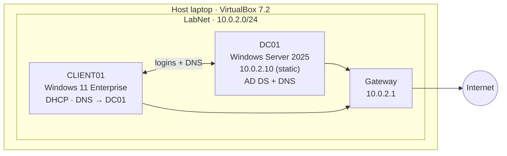

# Enterprise IT Operations & Automation Lab

A home lab that simulates the IT environment of a small company. I build and run it the way a help desk / IT support team would: a Windows domain, employee accounts, a ticketing system, automation with PowerShell, and documented troubleshooting.

> **Status:** Lab setup complete. Phase 2: OU structure, groups, and manual onboarding done; PowerShell automation next.

---

## Lab environment

| Machine | Role | OS | Network |
|---|---|---|---|
| **DC01** | Domain controller, DNS server | Windows Server 2025 Standard (Eval) | Static IP `10.0.2.10` |
| **CLIENT01** | Employee workstation, domain-joined | Windows 11 Enterprise (Eval) | DHCP, DNS → `10.0.2.10` |

- **Domain:** `lab.local` (NetBIOS: `LAB`)
- **Hypervisor:** Oracle VirtualBox 7.2.4 on Windows 11
- **Network:** VirtualBox NAT Network (`LabNet`) so the VMs can reach each other and the internet

---

## Project roadmap

| Phase | Description | Status |
|---|---|---|
| 0 | [Lab setup](docs/01-lab-setup.md): VMs, network, domain controller, domain join | ✅ Done |
| 1 | GLPI service desk: ticket categories, priorities, SLAs, knowledge base | ⬜ Planned |
| 2 | [Active Directory](docs/02-active-directory.md): OUs, users, groups, Group Policy, PowerShell onboarding/offboarding | 🔄 In progress |
| 3 | Ticket-driven operations: realistic tickets worked end to end | ⬜ Planned |
| 4 | Backup, failure & restore: measured recovery against a target time | ⬜ Planned |

---

## Documentation

- [Lab setup guide](docs/01-lab-setup.md): how the environment was built, step by step
- [Active Directory](docs/02-active-directory.md): OU design, security groups, and employee onboarding
- [Troubleshooting log](docs/troubleshooting-log.md): problems I hit and how I fixed them

---

## Skills demonstrated so far

- Virtualization (VirtualBox, NAT networking, snapshots)
- Windows Server 2025 installation and configuration
- Static IP addressing and DNS
- Active Directory Domain Services: creating a forest and promoting a domain controller
- Joining a Windows 11 client to a domain
- Designing an OU structure and role-based security groups
- Onboarding users in Active Directory Users and Computers and verifying access with `whoami /groups`
- Troubleshooting with `systeminfo`, `bcdedit`, `nslookup`, and Event Viewer

---

## Notes

- All machines, accounts, and data in this lab are fictional.
- No real passwords are stored in this repository.
