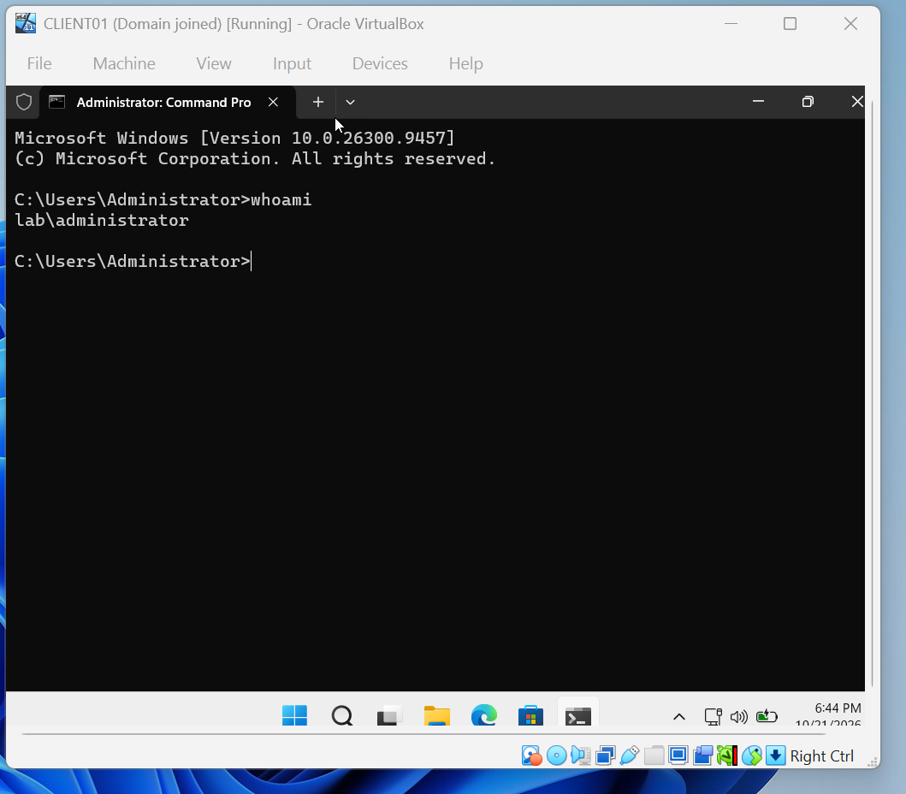

# Phase 0: Lab Setup

**Goal:** build a small "company" network on one laptop: a server that manages logins (domain controller) and an employee PC joined to it.

**Time spent:** ~4 sessions (Oct 14–21, 2026)

---

## Host machine

| Item | Value |
|---|---|
| CPU | Intel Core Ultra 7 165U (12 cores) |
| RAM | 32 GB |
| Storage | NVMe SSD |
| Hypervisor | Oracle VirtualBox 7.2.4 |

---

## 1. Create the lab network

**Why:** the server and the employee PC need to be on the same network so they can talk to each other, like two computers plugged into the same office switch. VirtualBox's default "NAT" setting isolates each VM, so I created a shared **NAT Network** instead.

**Steps:** VirtualBox → *File → Tools → Network Manager → NAT Networks → Create*

| Setting | Value |
|---|---|
| Name | `LabNet` |
| IPv4 prefix | `10.0.2.0/24` |
| DHCP | Enabled |


---

## 2. Build DC01 (the server)

**VM settings:** 4 GB RAM · 2 CPUs · 60 GB disk · Network: NAT Network → `LabNet`

**Install:** Windows Server 2025 Standard Evaluation **(Desktop Experience)**, manual install (unattended installation off). Installed VirtualBox Guest Additions afterward for screen resizing and clipboard support.


---

## 3. Rename the server and set a static IP

**Why a static IP:** every PC in the domain finds the domain controller by its IP address. If the address changed, logins would break, so servers get fixed addresses.

**Rename:** *Server Manager → Local Server → Computer name → Change* → `DC01` → restart

**Static IP:** *Ethernet → Properties → Internet Protocol Version 4 (TCP/IPv4)*

| Setting | Value | Why |
|---|---|---|
| IP address | `10.0.2.10` | Fixed address for the server |
| Subnet mask | `255.255.255.0` | All lab machines share `10.0.2.x` |
| Default gateway | `10.0.2.1` | VirtualBox's router to the internet |
| Preferred DNS | `127.0.0.1` | "Ask myself," since DC01 becomes the DNS server |


---

## 4. Install Active Directory Domain Services

*Server Manager → Manage → Add Roles and Features → Active Directory Domain Services*

This step only installs the software. It also added Group Policy Management and the AD admin tools.


---

## 5. Promote DC01 to a domain controller

**What promotion does:** creates the company's domain, builds the Active Directory database (users, computers, groups), and installs DNS so computers can find the server by name.

*Notification flag → Promote this server to a domain controller*

| Setting | Value |
|---|---|
| Deployment | Add a new forest |
| Root domain name | `lab.local` |
| NetBIOS name | `LAB` |
| DNS server / Global Catalog | Yes (defaults) |

After the restart, sign-in changed to **`LAB\Administrator`**, a domain account instead of a local one.


**Verified** in *Active Directory Users and Computers*: DC01 appears under **Domain Controllers**.


---

## 6. Build CLIENT01 (the employee PC)

**VM settings:** 4 GB RAM · 2 CPUs · 64 GB disk (Windows 11 minimum) · Network: `LabNet`. VirtualBox 7.2 provides the virtual TPM 2.0 and Secure Boot that Windows 11 requires.

**Install:** Windows 11 Enterprise Evaluation. During setup: *Set up for work or school → Sign-in options → Domain join instead* → created a local account `localadmin`. A company PC shouldn't be tied to a personal Microsoft account.

---

## 7. Point CLIENT01's DNS at DC01

**Why:** to join `lab.local`, the PC asks DNS "where is lab.local?" Only DC01's DNS knows the answer. Wrong DNS is one of the most common reasons domain joins fail.

*`ncpa.cpl` → Ethernet → IPv4* → keep IP automatic (DHCP), set **Preferred DNS: `10.0.2.10`**

**Tested with:**
```
nslookup lab.local
```
Result: answered by `10.0.2.10`, and `lab.local` resolves to `10.0.2.10`.
(`Server: UnKnown` is harmless; DC01 has no reverse lookup zone yet.)


---

## 8. Join CLIENT01 to the domain

*`sysdm.cpl` → Change* → Computer name `CLIENT01` → Member of Domain: `lab.local` → authenticated as `LAB\Administrator` → restart

**Verified:**
- Signed in to CLIENT01 as `LAB\Administrator`; `whoami` returns `lab\administrator`
- CLIENT01 appears in *Active Directory Users and Computers → Computers*




---

## 9. Snapshots

A snapshot was taken after each major step so the lab can be rolled back in seconds.

**DC01:** Fresh install → Guest Additions installed → static IP → DC promoted → Client joined
**CLIENT01:** Domain joined


---

## What I learned

- A **domain** lets one account work on every company computer; the domain controller checks every login.
- **DNS** isn't just for websites. Active Directory depends on it to locate the domain controller.
- Servers need **static IPs**; clients can use DHCP.
- Some Windows changes (like renaming a PC) only apply after a **restart** and can block other changes until then.

Problems encountered during setup are documented in the [troubleshooting log](troubleshooting-log.md).
