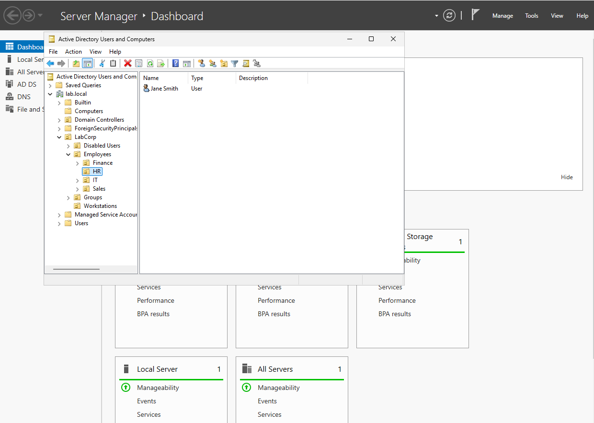
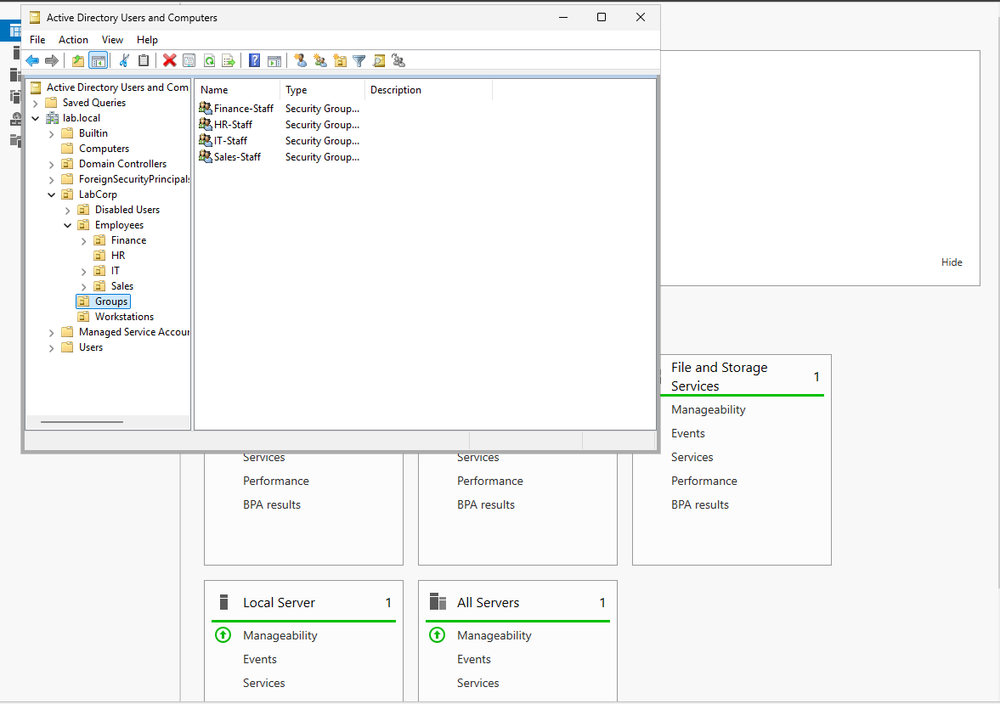
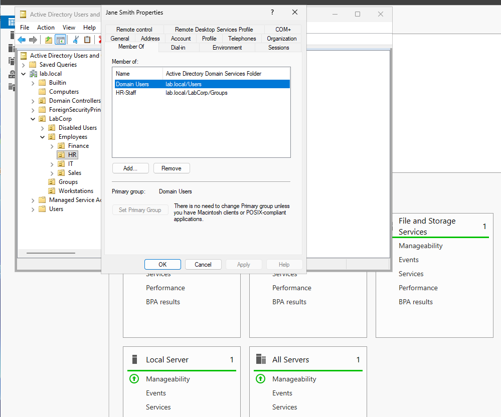
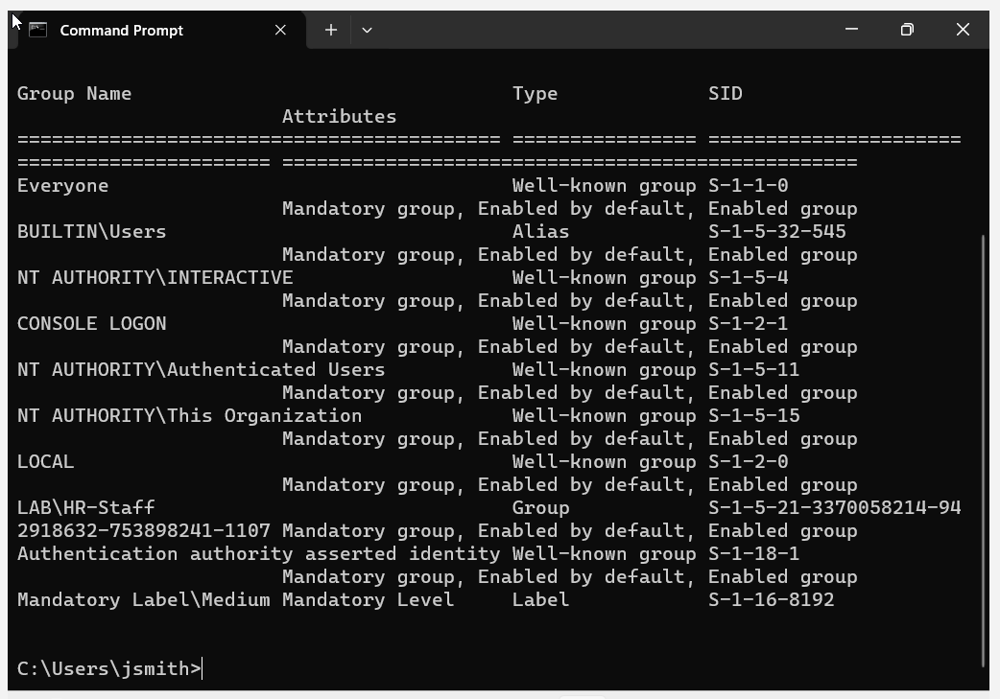
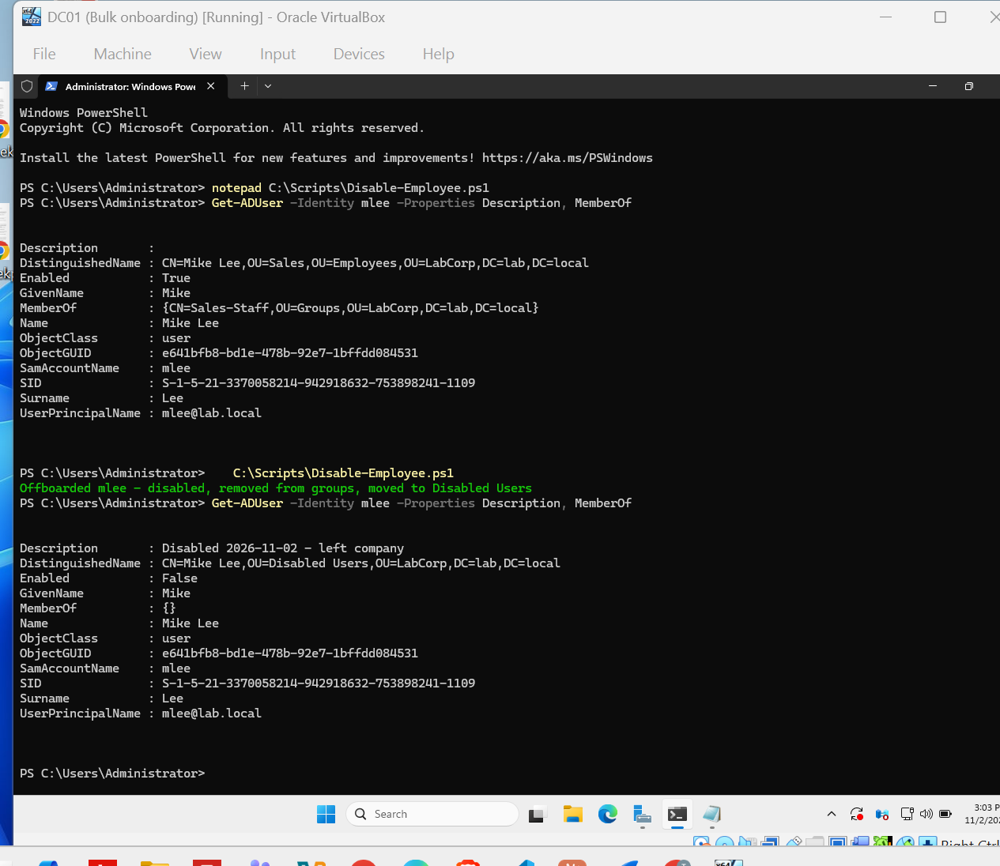

# Phase 2: Active Directory

**Goal:** organize the company in Active Directory and onboard employees the way a help desk would: first by hand to understand each step, then with PowerShell automation.

---

## Part 1: Company structure and manual onboarding

**Scenario:** LabCorp has four departments: IT, HR, Sales, and Finance. HR has sent IT two new hires to set up.

### Key concepts

| Term | What it is | Used for |
|---|---|---|
| **OU (Organizational Unit)** | A folder inside Active Directory | Organizing accounts and applying company rules (Group Policy). Each account lives in exactly **one** OU. |
| **Container** | Built-in folders like `Users` and `Computers` | Default locations. Group Policy **can't** be linked to containers, so I created my own OUs. |
| **Security group** | A list of members that can be given permissions | Access to folders, printers, and apps. A user can belong to **many** groups. |

**OU vs group in one sentence:** an OU is *where an account is filed*; a group is *what an account can access*.

---

### OU structure

Everything company-related lives under a single `LabCorp` OU, kept separate from Windows' built-in containers.

```
lab.local
└── LabCorp
    ├── Employees
    │   ├── IT
    │   ├── HR
    │   ├── Sales
    │   └── Finance
    ├── Groups
    ├── Workstations
    └── Disabled Users
```

| OU | Purpose |
|---|---|
| `Employees\<Department>` | User accounts, filed by department |
| `Groups` | Department security groups |
| `Workstations` | Domain-joined company PCs (so computer policies can be applied later) |
| `Disabled Users` | Accounts of employees who have left (used during offboarding) |

All OUs were created with **"Protect container from accidental deletion"** enabled.



---

### Department security groups

Created in `LabCorp\Groups`, all with **Group scope: Global** and **Group type: Security**.

| Group | Members |
|---|---|
| `IT-Staff` | (none yet) |
| `HR-Staff` | Jane Smith |
| `Sales-Staff` | Mike Lee |
| `Finance-Staff` | (none yet) |

Access is granted to **groups, not individual users**. When someone joins or leaves a department, IT only changes their group membership.



---

### Manual onboarding

| Employee | Logon name | OU | Group |
|---|---|---|---|
| Jane Smith | `jsmith` | `Employees\HR` | `HR-Staff` |
| Mike Lee | `mlee` | `Employees\Sales` | `Sales-Staff` |

**Steps for each new hire** (in *Active Directory Users and Computers*):

1. Right-click the department OU → **New → User**
2. First name, last name, and logon name using the company pattern (first initial + last name)
3. Set a **temporary password** and check **"User must change password at next logon"**, so IT never knows the employee's real password
4. Right-click the user → **Add to a group** → department group

**Verified:** Jane's *Member Of* tab shows `Domain Users` (automatic) and `HR-Staff`.



---

### Moving CLIENT01 into Workstations

Computers that join the domain land in the built-in `Computers` container by default. I moved CLIENT01 to `LabCorp\Workstations` so company-wide computer settings can be applied to it in the Group Policy part.

*ADUC → Computers → right-click CLIENT01 → Move → LabCorp\Workstations*

---

### Testing as the employee

Signed in to CLIENT01 as `LAB\jsmith`:

- Windows required a password change at first sign-in, as configured
- A new profile was created at `C:\Users\jsmith`
- `whoami /groups` lists **`LAB\HR-Staff`**, confirming her access from the employee's side
- `Mandatory Label\Medium` confirms she is a **standard user**, not an administrator



---

### What I learned

- An **OU** controls *where an account lives and which rules apply*; a **group** controls *what it can access*. Departments often have both, but they serve different purposes, and a user can wear many "group hats" while living in one OU.
- Built-in **containers** look like folders but can't receive Group Policy, which is why companies build their own OU structure.
- Setting a **temporary password with a forced change** keeps IT from ever knowing users' real passwords.
- Account creation isn't finished until it's **tested from the user's side**. `whoami /groups` is a quick way to verify access.
- Every user and group has a **SID** (security identifier). Windows tracks permissions by SID, so renaming a group doesn't break its access.

---

## Part 2: PowerShell onboarding automation

**Script:** [`scripts/New-Employee.ps1`](../scripts/New-Employee.ps1)

### What I built and learned

I wrote a PowerShell script that onboards a new employee: it builds the username from their name, creates the account in their department’s OU with a temporary password, and adds them to the department’s security group. While testing, I found that the script reported success even when it failed, for example when the user already existed or the department was misspelled, and one error caused a chain of other errors. I fixed this by adding input validation with if statements: the script now checks that the department is valid and that the username isn’t taken before creating anything, and stops with a clear error message if not. I also learned how to read PowerShell errors (fix the first one), why `-Filter` works better than `-Identity` for checks, and that variables only expand inside double quotes.

---

## Part 3: Bulk onboarding from a CSV

**Script:** [`scripts/Import-Employees.ps1`](../scripts/Import-Employees.ps1)
**Sample input:** [`scripts/new-hires.csv`](../scripts/new-hires.csv)

HR usually sends new hires as a spreadsheet. This script reads a CSV file and runs the onboarding steps once per row using a `foreach` loop. Invalid rows are skipped with `continue` instead of stopping the whole batch.

**Test run** (six rows, including two deliberate mistakes):

| Row | Result |
|---|---|
| Aisha Khan, Tom Nguyen, Sara Lopez, David Chen | ✅ Created in their department OU and group |
| Jane Smith | ⚠️ Skipped: username already exists |
| Emily Brooks (Marketing) | ❌ Skipped: invalid department |

### What I learned

Instead of running the single-user script once per new hire, I turned it into a loop that reads every row of a CSV file, the format HR would actually send. My first version had a bug: I closed the `foreach` loop's brace right after setting the variables, so only those three lines repeated and the account-creation steps ran just once, using the last row. I learned that only the code between `{` and `}` repeats. I also learned the difference between `exit`, which stops the whole script, and `continue`, which skips the current row and moves on to the next one. That way one bad row doesn't stop the whole batch. In my test, four valid hires were created, and the duplicate and invalid-department rows were skipped with clear, color-coded messages.

---

## Part 4: Offboarding

**Script:** [`scripts/Disable-Employee.ps1`](../scripts/Disable-Employee.ps1)

When an employee leaves, the account is **disabled, not deleted**, so it can be restored if needed and its SID and history are kept. The script:

1. Stops if the username doesn't exist
2. Disables the account
3. Removes all group memberships except Domain Users
4. Adds a dated note to the Description field
5. Moves the account to the `Disabled Users` OU

**Before and after offboarding Mike Lee:**

| | Before | After |
|---|---|---|
| Enabled | True | **False** |
| OU | `Employees\Sales` | `Disabled Users` |
| Groups | Sales-Staff | *(none)* |
| Description | *(empty)* | `Disabled 2026-11-02 - left company` |



Running it with a username that doesn't exist stops with *"User 'nobody' not found. No changes made."*

### What I learned

Offboarding matters for security, because a former employee's active account is a common way attackers get in. Companies disable accounts instead of deleting them because deletion can't be undone, and the account's history, files, and permissions may still be needed for audits or if the person returns. After offboarding Mike Lee, his SID, GUID, and username stayed the same, so he could be re-enabled with everything tied to his account intact. The script checks that the user exists before doing anything, so a typo in the username stops it with a clear message instead of a chain of errors. I also learned to verify changes with a before-and-after comparison, using `Get-ADUser -Properties` to show fields like Description and MemberOf.
