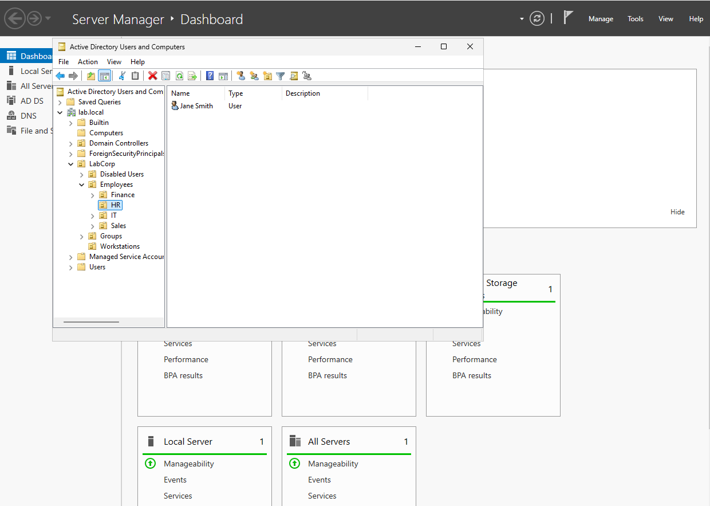
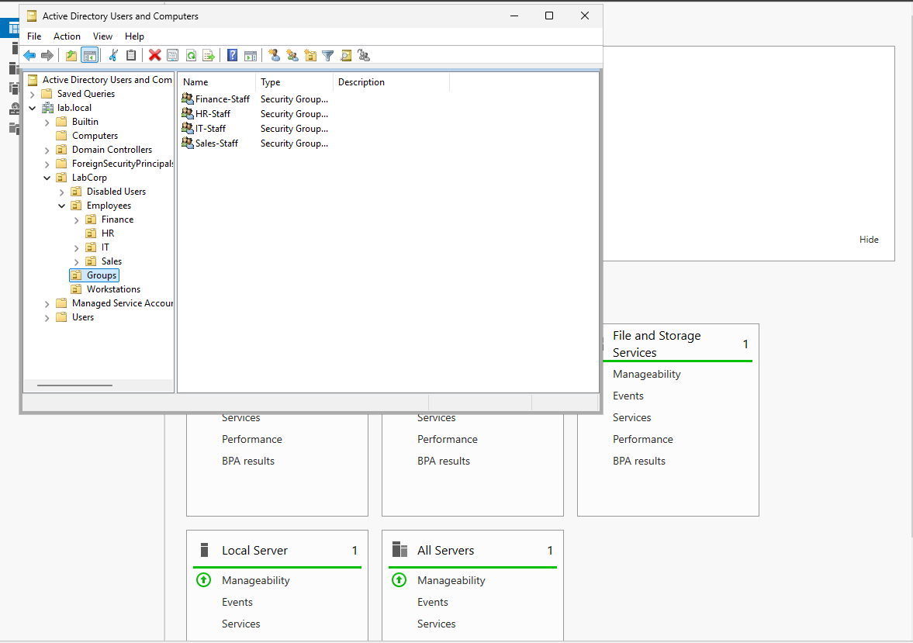
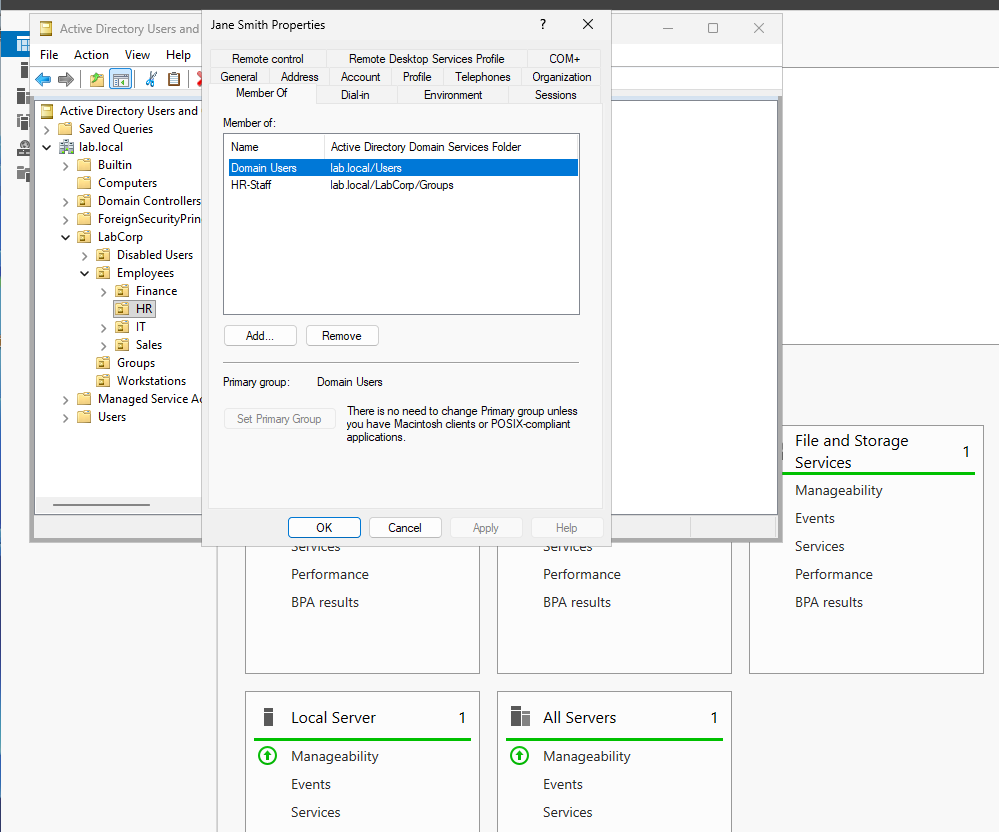
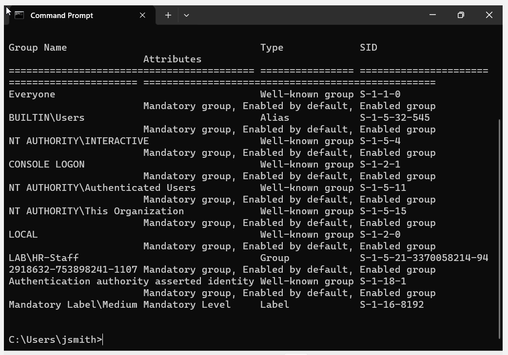

# Phase 2: Active Directory

**Goal:** organize the company in Active Directory and onboard employees the way a help desk would: first by hand to understand each step, then with PowerShell automation.

---

## Part 1: Company structure and manual onboarding

**Scenario:** LabCorp has four departments: IT, HR, Sales, and Finance. HR has sent IT two new hires to set up.

### Key concepts

| Term | What it is | Used for |
|---|---|---|
| **OU (Organizational Unit)** | A folder inside Active Directory | Organizing accounts and applying company rules (Group Policy). Each account lives in exactly **one** OU. |
| **Container** | Built-in folders like `Users` and `Computers` | Default locations. Group Policy **can't** be linked to containers, so I created my own OUs. |
| **Security group** | A list of members that can be given permissions | Access to folders, printers, and apps. A user can belong to **many** groups. |

**OU vs group in one sentence:** an OU is *where an account is filed*; a group is *what an account can access*.

---

### OU structure

Everything company-related lives under a single `LabCorp` OU, kept separate from Windows' built-in containers.

```
lab.local
└── LabCorp
    ├── Employees
    │   ├── IT
    │   ├── HR
    │   ├── Sales
    │   └── Finance
    ├── Groups
    ├── Workstations
    └── Disabled Users
```

| OU | Purpose |
|---|---|
| `Employees\<Department>` | User accounts, filed by department |
| `Groups` | Department security groups |
| `Workstations` | Domain-joined company PCs (so computer policies can be applied later) |
| `Disabled Users` | Accounts of employees who have left (used during offboarding) |

All OUs were created with **"Protect container from accidental deletion"** enabled.



---

### Department security groups

Created in `LabCorp\Groups`, all with **Group scope: Global** and **Group type: Security**.

| Group | Members |
|---|---|
| `IT-Staff` | (none yet) |
| `HR-Staff` | Jane Smith |
| `Sales-Staff` | Mike Lee |
| `Finance-Staff` | (none yet) |

Access is granted to **groups, not individual users**. When someone joins or leaves a department, IT only changes their group membership.



---

### Manual onboarding

| Employee | Logon name | OU | Group |
|---|---|---|---|
| Jane Smith | `jsmith` | `Employees\HR` | `HR-Staff` |
| Mike Lee | `mlee` | `Employees\Sales` | `Sales-Staff` |

**Steps for each new hire** (in *Active Directory Users and Computers*):

1. Right-click the department OU → **New → User**
2. First name, last name, and logon name using the company pattern (first initial + last name)
3. Set a **temporary password** and check **"User must change password at next logon"**, so IT never knows the employee's real password
4. Right-click the user → **Add to a group** → department group

**Verified:** Jane's *Member Of* tab shows `Domain Users` (automatic) and `HR-Staff`.



---

### Moving CLIENT01 into Workstations

Computers that join the domain land in the built-in `Computers` container by default. I moved CLIENT01 to `LabCorp\Workstations` so company-wide computer settings can be applied to it in the Group Policy part.

*ADUC → Computers → right-click CLIENT01 → Move → LabCorp\Workstations*

---

### Testing as the employee

Signed in to CLIENT01 as `LAB\jsmith`:

- Windows required a password change at first sign-in, as configured
- A new profile was created at `C:\Users\jsmith`
- `whoami /groups` lists **`LAB\HR-Staff`**, confirming her access from the employee's side
- `Mandatory Label\Medium` confirms she is a **standard user**, not an administrator



---

### What I learned

- An **OU** controls *where an account lives and which rules apply*; a **group** controls *what it can access*. Departments often have both, but they serve different purposes, and a user can wear many "group hats" while living in one OU.
- Built-in **containers** look like folders but can't receive Group Policy, which is why companies build their own OU structure.
- Setting a **temporary password with a forced change** keeps IT from ever knowing users' real passwords.
- Account creation isn't finished until it's **tested from the user's side**. `whoami /groups` is a quick way to verify access.
- Every user and group has a **SID** (security identifier). Windows tracks permissions by SID, so renaming a group doesn't break its access.

---

## Part 2: PowerShell onboarding automation

**Script:** [`scripts/New-Employee.ps1`](../scripts/New-Employee.ps1)

### What I built and learned

I wrote a PowerShell script that onboards a new employee: it builds the username from their name, creates the account in their department’s OU with a temporary password, and adds them to the department’s security group. While testing, I found that the script reported success even when it failed, for example when the user already existed or the department was misspelled, and one error caused a chain of other errors. I fixed this by adding input validation with if statements: the script now checks that the department is valid and that the username isn’t taken before creating anything, and stops with a clear error message if not. I also learned how to read PowerShell errors (fix the first one), why `-Filter` works better than `-Identity` for checks, and that variables only expand inside double quotes.

*Next: bulk onboarding from a CSV file.*
