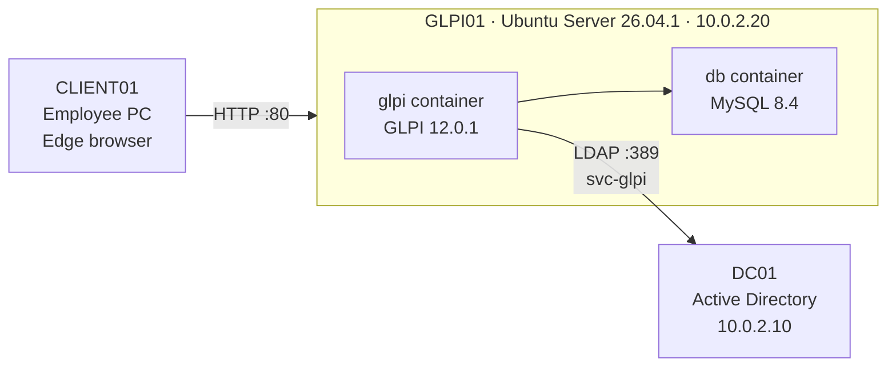
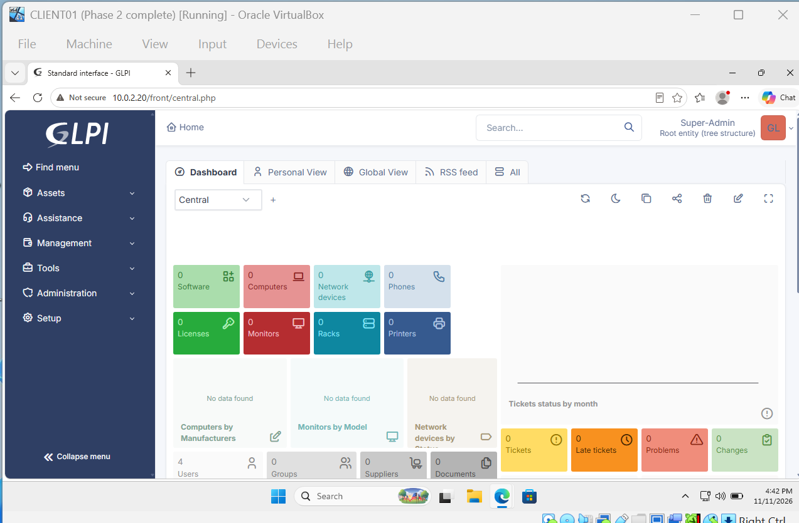
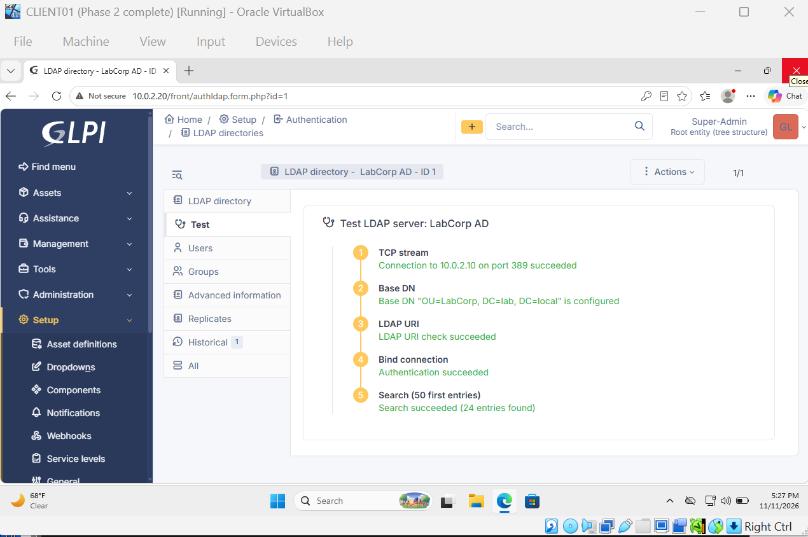
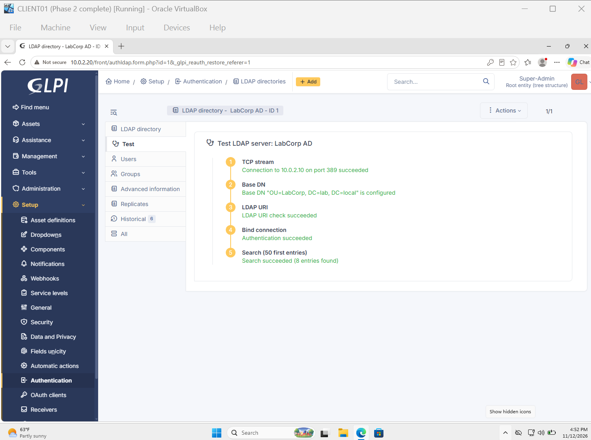
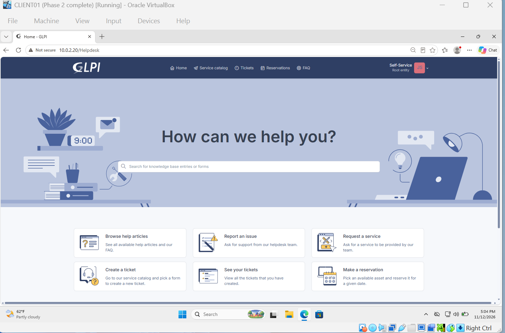

# Phase 1: GLPI Service Desk

**Goal:** give LabCorp a help desk where employees submit tickets and IT tracks them, running on its own Linux server and using the company's Active Directory accounts for login.

**Status:** GLPI installed, secured, and connected to Active Directory. Ticket categories, SLAs, and knowledge base are next.

> **Known limitation:** GLPI (HTTP) and the LDAP connection to DC01 (port 389, signing relaxed) are currently **unencrypted**. This is acceptable only because the lab is an isolated private network with fictional accounts. HTTPS for GLPI and LDAPS for AD, using certificates from an internal AD Certificate Services CA, are planned.

---

## Architecture



| Item | Value |
|---|---|
| Server | **GLPI01**, Ubuntu Server 26.04.1 LTS, 4 GB RAM, 25 GB disk |
| Network | Static IP `10.0.2.20/24`, gateway `10.0.2.1`, DNS `10.0.2.10`, search domain `lab.local` |
| Admin access | SSH from DC01: `ssh labadmin@10.0.2.20` |
| App | GLPI **12.0.1** (official `glpi/glpi` Docker image) + MySQL 8.4 |
| URL | `http://10.0.2.20` |

**Why a separate server:** one main role per server. The domain controller holds every password in the company, so it stays as locked down as possible, and a problem with GLPI can't take logins down with it.

---

## 1. Build GLPI01

- Created a new VirtualBox VM on the `LabNet` NAT Network.
- Installed **Ubuntu Server 26.04.1 LTS** (chose LTS for 5 years of updates; servers shouldn't need a major upgrade every year).
- Set a **static IP** in the installer (Manual IPv4), because employees need a fixed address to reach the help desk.
- Installed updates: `sudo apt update && sudo apt upgrade -y`
- Verified connectivity and DNS: `ping -c 3 dc01.lab.local` → replies from `10.0.2.10`

---

## 2. Install Docker

GLPI needs a web server, PHP, and a database. Docker runs them as pre-built **containers**, so the whole setup is described in one file instead of installing and connecting each piece by hand.

```bash
sudo apt install -y docker.io docker-compose-v2
sudo usermod -aG docker labadmin   # group membership grants access (re-login required)
docker run hello-world             # test container
```

---

## 3. Enable remote management (SSH)

The server console has no copy-paste, so I manage GLPI01 from DC01 over SSH.

```bash
sudo apt install -y openssh-server
sudo systemctl enable --now ssh
```

On first connection, I compared the SSH host key fingerprint with the one shown during the server's first boot to confirm I was connecting to the real server.

---

## 4. Deploy GLPI with Docker Compose

Files in `~/glpi/` on GLPI01:

**`.env`** (database connection settings; real password not shown):
```
GLPI_DB_HOST=db
GLPI_DB_PORT=3306
GLPI_DB_NAME=glpi
GLPI_DB_USER=glpi
GLPI_DB_PASSWORD=<redacted>
```

**`docker-compose.yml`:**
```yaml
services:
  glpi:
    image: "glpi/glpi:latest"
    restart: "unless-stopped"
    volumes:
      - "./storage/glpi:/var/glpi:rw"
    env_file: .env
    depends_on:
      db:
        condition: service_healthy
    ports:
      - "80:80"

  db:
    image: "mysql:8.4"
    restart: "unless-stopped"
    volumes:
      - "./storage/mysql:/var/lib/mysql"
    environment:
      MYSQL_RANDOM_ROOT_PASSWORD: "yes"
      MYSQL_DATABASE: ${GLPI_DB_NAME}
      MYSQL_USER: ${GLPI_DB_USER}
      MYSQL_PASSWORD: ${GLPI_DB_PASSWORD}
    healthcheck:
      test: ["CMD", "mysqladmin", "ping", "-h", "127.0.0.1"]
      interval: 5s
      timeout: 5s
      retries: 10
```

| Setting | Why |
|---|---|
| `volumes` | Data is stored on GLPI01 outside the containers, so tickets survive if a container is rebuilt |
| `ports: "80:80"` | Makes GLPI reachable at `http://10.0.2.20` |
| `depends_on` + `healthcheck` | GLPI waits until the database is actually answering |
| `restart: unless-stopped` | Containers come back automatically after a reboot (confirmed after restarting GLPI01) |

```bash
docker compose up -d
docker compose ps    # glpi: Up, db: Up (healthy)
```

The first start failed with `Permission denied` on `/var/glpi/config`. The fix was giving the container's `www-data` user (uid 33) ownership of the data folder: `sudo chown -R 33:33 ./storage/glpi`. Details are in the [troubleshooting log](troubleshooting-log.md).

---

## 5. Secure the default installation

GLPI ships with four default accounts whose passwords are publicly documented, so attackers try them first.

| Account | Action |
|---|---|
| `glpi` (Super-Admin) | Password changed |
| `tech`, `normal`, `post-only` | **Deactivated** in bulk (Administration → Users → select → Actions → Update → Active = No). Deactivated rather than deleted, so it's reversible |
| `glpi-system` | Left alone: GLPI's internal account for background tasks |

Also disabled the **demonstration data**. The default-password warning on the dashboard is gone.



---

## 6. Connect GLPI to Active Directory (LDAP)

**Goal:** employees sign in to GLPI with their existing AD account, and disabling someone in AD removes their GLPI access too. AD is the single source of truth.

### Service account

GLPI reads AD with a dedicated **service account** (an account for an application, not a person):

```powershell
$Password = Read-Host -AsSecureString "Password for svc-glpi"
New-ADUser -Name "svc-glpi" -SamAccountName "svc-glpi" -UserPrincipalName "svc-glpi@lab.local" `
  -Path "CN=Users,DC=lab,DC=local" -AccountPassword $Password -Enabled $true `
  -PasswordNeverExpires $true -Description "Service account for GLPI LDAP connection"
```

- A normal domain user can read AD, so no admin rights are needed (**least privilege**).
- `PasswordNeverExpires`, because an expired service account password silently breaks the integration.
- It lives outside `OU=LabCorp`, so it can't log in to GLPI itself.

### LDAP directory settings

*Setup → Authentication → LDAP directories → Add*

| Setting | Value |
|---|---|
| Server / Port | `10.0.2.10` / `389` |
| BaseDN | `OU=LabCorp,DC=lab,DC=local` |
| RootDN (bind account) | `svc-glpi@lab.local` |
| Login field | `samaccountname` |
| Connection filter | `(&(objectClass=user)(objectCategory=person)(!(userAccountControl:1.2.840.113556.1.4.803:=2)))` |

**What the filter does:**

| Filter | Entries found | What it removes |
|---|---|---|
| *(empty)* | 24 | nothing (OUs, groups, computers, users) |
| `(objectClass=user)` | 11 | groups and OUs |
| `+ (objectCategory=person)` | 10 | CLIENT01's computer account |
| `+ (!(userAccountControl:...:=2))` | **8** | disabled accounts (mlee, tnguyen) |

**Domain controller change:** Windows Server 2025 rejects unsigned LDAP binds by default (error 8). For the lab, I relaxed this in the **Default Domain Controllers Policy** (*Domain controller: LDAP server signing requirements* = None, *Enforcement* = Disabled). In production I would keep signing on and use **LDAPS** instead.





### Import users

GLPI 12 includes a command-line tool. I found the right command by listing what was available:

```bash
docker compose exec -u www-data glpi php bin/console list ldap
docker compose exec -u www-data glpi php bin/console ldap:sync --only-create-new
```

The first sync ran before the filter was set and imported groups and disabled users as GLPI users. I moved those wrong imports to the trashbin, added the filter, and confirmed the directory now returns only the 8 active employees.

### Verification

Signed in to GLPI as **`jsmith`** with her Windows password. GLPI checked the password with DC01 over LDAP, and Jane landed on the **Self-Service** portal (`/Helpdesk`), with only the employee menus (Home, Service catalog, Tickets, Reservations, FAQ). No Setup or Administration.



---

## What I learned

I put GLPI on its own Linux server instead of the domain controller because each server should have one main job. DC01 holds every password in the company, so it stays as locked down as possible, and if GLPI crashes or needs a restart, logins keep working. Docker made the install manageable: one Compose file describes GLPI and its database, and `restart: unless-stopped` brought both back automatically after a reboot. The first start failed because the data folder was owned by root while GLPI runs as `www-data`, which taught me that containers run as their own users and shared folders need matching ownership.

Before doing anything else in GLPI, I removed the default access: changed the admin password and deactivated the three other built-in accounts, since their passwords are publicly known. Connecting GLPI to Active Directory means employees use one account everywhere, and disabling someone in AD also removes their help desk access. GLPI reads AD with a dedicated service account that has no admin rights (least privilege), and its password never expires so the integration doesn't silently break.

The LDAP filter mattered more than I expected. Without it, the first sync imported groups and offboarded employees as if they were people. "Success, 15 imported" only looked wrong because I knew the right number was 8. When the full filter then failed with a syntax error, I tested it one piece at a time (11 → 10 → 8 entries) until I found the problem. I also learned that a changing error code means progress: error 49 meant the account didn't exist (two commands had been pasted as one line), and error 8 meant Windows Server 2025 requires signed LDAP, which I relaxed for the lab and plan to replace with LDAPS. The biggest habit from this phase: always verify the result instead of trusting that no error means it worked.

---

## Next

- Ticket categories, priorities, and SLAs for LabCorp
- Knowledge base articles
- First tickets submitted by employees (Phase 3)
- Later: HTTPS for GLPI and LDAPS for AD with AD Certificate Services
